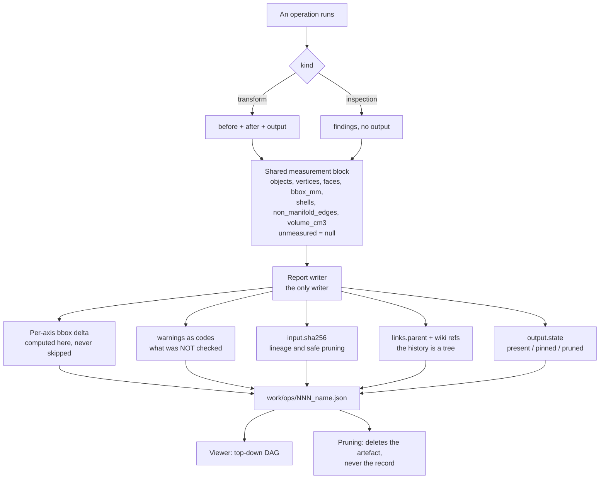

## adr_001_operation_report_format - Operation report format
> Date: 2026-08-21
> Status: Accepted
> Related request: `req_000_make_every_3d_operation_reviewable_without_reopening_blender`
> Related backlog: `item_001_define_the_operation_report_and_write_one_from_every_operation`
> Related task: `task_001_deliver_the_reviewable_operation_loop`
> Drivers: reviewability without reopening the 3D application, lineage across a branching history, safe pruning of heavy artefacts, agent-readable outcomes
> Reminder: Update status, linked refs, decision rationale, consequences, and follow-up work when you edit this doc.
> Indicators reviewed: 2026-08-21 22:27:37

# Overview
- One JSON envelope per operation, written by a single helper, carrying what was measured, what it was measured against, and what was not checked -- so a result can be reviewed, and a chain of results navigated, from the reports alone.

# Context
- Twelve scripts exist today. Seven transform a file and print measurements before and after; five only measure and produce no output file at all. A format that assumes an input and an output cannot describe the second kind, and inspections are where half the review actually happens.
- The measurements already printed converge on a small core: bounding box in millimetres, volume, shell count, non-manifold edge count, object and vertex counts. Five of the seven pipeline steps print four of those five. The format records what the scripts already compute; it does not ask them to compute something new.
- `pipeline/03_recenter.py` already prints the bounding box before and after, which is the comparison the runbooks name as the check that caught every failure in the delivered chain while the manifold checks passed throughout.
- Prior art in the same house: cm-sim's `transformation-report.json` carries `schema_version`, `created_at`, a source block with a SHA-256 fingerprint and a `read_only` mode, a settings block, before and after mesh blocks, a validation block, and warnings as short codes rather than sentences.
- The history of this work is a tree, not a line. `run_007` records three failed approaches before the one that worked, and those three carry most of the runbook's value. A representation that keeps only what succeeded destroys the more useful half.
- Artefacts are heavy and reports are not: a blend is 200 MB, an STL 68 MB, a report a few kilobytes. Whatever pruning policy arrives later will delete artefacts, never records.

# Decision
- **One envelope, two payloads.** Every report carries the same envelope: `schema_version`, `id`, `chain`, `created_at`, `kind` (`transform` or `inspection`), `operation`, `script`, `engine`, `params`, `tool`, `status` (`ok` or `failed`), `input`, `warnings`, `renders`, `links`. A `transform` adds `before`, `after` and `output`; an `inspection` adds `findings` and no output.
- **The core measurement block is shared.** `objects`, `vertices`, `faces`, `bbox_mm` (min and max per axis), `shells`, `non_manifold_edges`, `volume_cm3`. A field the operation did not measure is `null`, never absent and never zero.
- **The bounding-box comparison is computed by the helper, not by the operation.** A `transform` report states the per-axis delta between `before.bbox_mm` and `after.bbox_mm`, and names the axes that moved. No operation can omit the check that catches what the manifold checks miss.
- **Parameters are recorded, resolved.** `params` carries every parameter of the operation with the value actually used, defaults included, each with its unit. Without it two runs of the same operation are indistinguishable on the only thing that differs: a voxel at 6 mm and a voxel at 30 mm produced the whole failure demonstration, and the format could not tell them apart. Operations declare their parameters -- name, type, default, unit -- in a manifest the runner reads to parse the command line and the report reads to record the resolution.
- **The tool records itself.** `tool` carries the meshanvil version, the engine and its version and build hash, and the platform. A remesh does not produce the same mesh across two Blender versions; without this block, numbers from different versions are compared as if they were comparable. With it, the viewer can say so.
- **The engine is named.** `engine` is `blender` or `freecad`. The process model is the same either way -- a job in, a report out -- so a second engine is a different binary, not a different architecture.
- **Inputs are fingerprinted.** `input` carries the path and a SHA-256, as cm-sim does. The fingerprint is what makes lineage verifiable and pruning safe: a report describes a known set of bytes, whether or not those bytes still exist.
- **Unchecked is stated, not implied.** What an operation did not verify goes in `warnings` as a short code (`topology_not_checked`, `source_completeness_not_verified`, `thin_parts_below_ray_grid`), following cm-sim. A code is actionable by an agent; a sentence is not.
- **A failure still reports.** `status: failed` carries the error and the measurements taken before it, because a failed attempt is a branch of the history and not a discarded run.
- **The parent is derived, not declared.** `links.parent` is resolved by fingerprint: the report whose `output.sha256` equals this operation's `input.sha256`. The rule lives in `adr_005_execution_contract_identity_concurrency_and_exit_codes`; the format only records the result, and whether it was derived or overridden.
- **Lineage lives in the file.** `links` carries the parent report id and wiki-style references to the documents involved (`[[run_009_repair_export_defects_in_a_cad_derived_mesh]]`, `[[item_003_read_the_chain_of_operations_in_a_local_viewer]]`). A report opened alone in a text editor stays understandable without the tool that wrote it, and without any index or database.
- **Artefact state is a field from the start.** `output.state` is `present`, `pinned` or `pruned`, with the date when it changed. Retrofitting three fields onto reports already written is a migration worth avoiding for the price of declaring them now.
- **Renders are declared, not discovered.** `renders[]` carries, for each image, its canonical direction, its path and the camera used. `renders[0]` is the tile thumbnail. The viewer never infers a view from a filename.
- **Comparable pairs are declared too.** A `transform` that rendered its input state as well lists the pairs in `compare[]`, one per direction, each naming the two images and the camera they share. Without that declaration there is no comparison, because two images on two cameras prove nothing.
- **Reports are immutable except for artefact state.** Nothing else in a written report is edited afterwards.

# Consequences
- The viewer renders the chain as a deterministic top-down DAG from `links.parent`, time running vertically and branches horizontally, rather than a force-directed graph. On ten nodes a physics simulation says less than a tree; it also discards the ordering, which is the most useful axis here. A graph view stays an open question in `prod_001`, to be answered when the node count makes a tree fail.
- Adding an operation means calling the helper, not defining a format. An operation that reports in a shape of its own is a defect.
- The five inspection scripts become first-class: their findings are recorded and navigable instead of scrolling out of a terminal.
- A pruning policy can be written later without touching the format, because `input.sha256` and `output.state` are already there. That policy is its own slice.
- The helper needs the scene both before and after, so operations that save and reopen files must hand it the measurements rather than the paths.
- An operation that wants to be compared must render its input state on the output's camera, which costs one extra render pass and is why `item_005` carries a fixed-camera render mode rather than the per-object framing used today.
- Recording `params` and `tool` costs a few hundred bytes per report and is what makes two reports comparable at all. Any comparison across different `tool.engine_version` values is flagged rather than silently drawn.
- The format is versioned from the first write. `schema_version` is bumped on any change to the shape, and the viewer refuses a version it does not know rather than rendering it wrong.

# References
- Prior art: `transformation-report.json` in the cm-sim printable-preparation flow (schema_version, source fingerprint, warning codes)
- The check the format makes mandatory: `run_006_turn_a_cad_assembly_into_a_printable_solid`, "compare the output bounding box against the source"
- The branching history this format must keep: `run_007_hollow_a_printable_body_for_electronics`, three failed approaches
- Related request: `req_000_make_every_3d_operation_reviewable_without_reopening_blender`
- Related backlog: `item_001_define_the_operation_report_and_write_one_from_every_operation`
- Related task: `task_001_deliver_the_reviewable_operation_loop`
