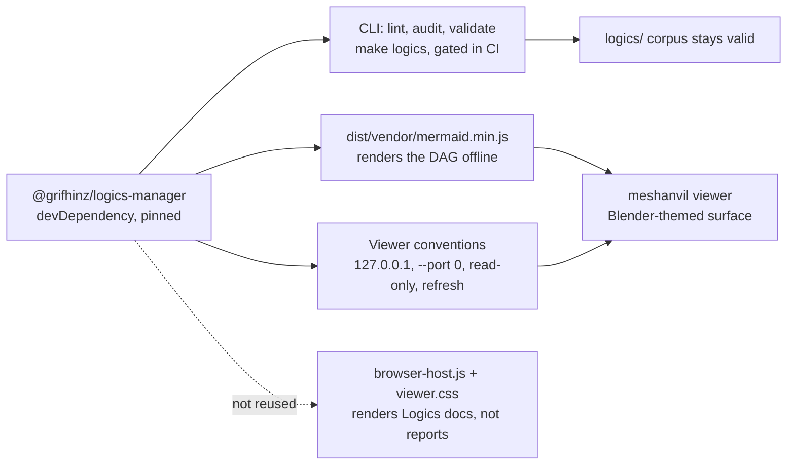

## adr_002_depend_on_logics_manager_and_reuse_its_structure - Depend on logics-manager and reuse its structure
> Date: 2026-08-21
> Status: Accepted
> Related request: `req_000_make_every_3d_operation_reviewable_without_reopening_blender`
> Related backlog: `item_003_read_the_chain_of_operations_in_a_local_viewer`
> Related task: `task_001_deliver_the_reviewable_operation_loop`
> Drivers: a corpus that is part of the deliverable, an offline viewer, proven local-server conventions, no second implementation of what already exists
> Reminder: Update status, linked refs, decision rationale, consequences, and follow-up work when you edit this doc.

# Overview
- The @grifhinz/logics-manager package becomes a declared devDependency rather than an assumed global tool, and meshanvil reuses three things it already ships -- the pinned CLI, the vendored Mermaid bundle, and the local-viewer conventions -- while implementing its own viewer surface.

# Context
- The corpus in `logics/` is part of what this repository delivers, not scaffolding around it. A contributor who cannot run `lint` and `audit` cannot check their own change, and a globally installed tool is a different version for every machine.
- `item_003` requires a viewer that opens with no network access. Mermaid is the natural way to draw the operation DAG, and the package already vendors a Mermaid bundle, so the dependency removes a CDN rather than adding one.
- The package also ships a working local viewer: bound to `127.0.0.1`, `--port 0` for an automatic port, read-only mode, a refresh cadence, and a preferences file beside the repository. Those conventions were paid for once already.
- What it ships for rendering -- its browser-host bundle and stylesheet, some twenty thousand lines -- renders Logics documents. It is a full design system for a different subject, and the viewer surface here follows Blender's interface language instead.
- The other repositories in the same house already carry a `package.json` for exactly this kind of tooling dependency, so this is the existing convention rather than a new one.

# Decision
- **Declare the dependency.** the package is a devDependency in `package.json`, with `package-lock.json` committed. `make logics` runs `npx --no-install`, so the pinned version runs or the command fails loudly; it never silently falls back to whatever is on `PATH`.
- **Gate the corpus in CI.** The workflow runs `npm ci`, then `make check`, then `make logics`. A corpus that stops linting is a failed build, on the same footing as a script that stops compiling.
- **Take the Mermaid bundle from the dependency.** The viewer loads it from the installed package, keeping the no-network requirement of `item_003` AC3 without vendoring a copy of our own.
- **Copy the viewer conventions, not the viewer.** Bind to `127.0.0.1`, take `--port 0`, stay read-only over `work/ops/`, refresh on an interval. Same behaviour, own surface.
- **Do not reuse the Logics viewer for reports.** It renders workflow documents; an operation timeline is not one. Reusing it would mean an extension point in another repository for a display this repository can serve from a static page.

# Consequences
- Contributing now needs Node for the corpus checks. Python and Blender remain the only requirements for running the operations themselves, which is the part that matters to a 3D user.
- The Logics CLI version is visible in a lockfile and moves in a commit, so a corpus that lints today lints tomorrow.
- The viewer's dependency footprint is one vendored file taken from a package that is already installed, and it stays offline.
- If the operation timeline ever justifies living inside the Logics viewer, it becomes a request in that repository, with this decision as the record of why it did not start there.
- Two repositories now move together on the workflow tooling. That coupling is deliberate and bounded to the corpus; nothing in `pipeline/` or `tools/` imports it.

# References
- Reused: the Logics CLI, its vendored Mermaid bundle, its local-viewer conventions
- Not reused: the Logics viewer browser-host bundle and stylesheet
- Report format this viewer reads: `adr_001_operation_report_format`
- Related request: `req_000_make_every_3d_operation_reviewable_without_reopening_blender`
- Related backlog: `item_003_read_the_chain_of_operations_in_a_local_viewer`
- Related task: `task_001_deliver_the_reviewable_operation_loop`
