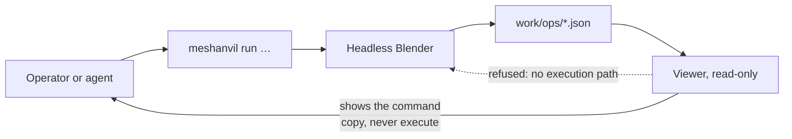

## adr_003_the_viewer_reads_the_command_acts - The viewer reads, the command acts
> Date: 2026-08-21
> Status: Accepted
> Related request: `req_000_make_every_3d_operation_reviewable_without_reopening_blender`
> Related backlog: `item_003_read_the_chain_of_operations_in_a_local_viewer`
> Related task: `task_001_deliver_the_reviewable_operation_loop`
> Drivers: one way in for every agent, a viewer that cannot damage anything, menus that teach the command rather than hide it
> Reminder: Update status, linked refs, decision rationale, consequences, and follow-up work when you edit this doc.
> Indicators reviewed: 2026-08-22 01:17:52

# Overview
- The viewer never runs an operation. Every action it offers -- run, re-run, branch, prune, re-render, open in Blender -- is presented as the exact command that does it, ready to copy, and the operator or the agent runs it themselves.

# Context
- The mockup's menus name real actions: Run operation, Re-run selected, Branch from selected, Prune artefacts, Re-render this view, Open in Blender. Drawing them raised the question they imply: does the page execute, or does it teach?
- A viewer that executes needs a privileged local server, a job queue, cancellation, concurrency against a Blender process that may already hold the file, and a security boundary on a page any browser tab can reach. None of that serves the stated goal, which is reviewing.
- `item_002_run_one_named_operation_from_a_single_agent_agnostic_command` already delivers one command that any runtime can call. A second execution path through the viewer would mean two ways to run the same operation, and the reports would no longer record a single provenance.
- The operator works next to an agent. A command shown on screen is a command the agent can be handed; a button is not.

# Decision
- **The viewer is read-only over `work/ops/` and `work/renders/`.** It opens files, it writes nothing, it starts no process.
- **Every action is a command, shown in full**, with a copy affordance, in the place where the action would have been. `Prune artefacts…` shows `meshanvil prune --keep 3 --dry-run`; `Re-render this view` shows `meshanvil run render_views --op 006a`.
- **Empty states carry the command that fills them.** A viewer with no reports is not an error; it is a page that says which command produces the first one.
- **`Open in Blender` is the single exception considered and refused for now.** Handing a path to the operating system is not running an operation, but it is still a side effect from a page; it stays a shown command until someone asks for it.
- **This is reversible and the reversal has a price.** Executing later means a local server with authentication, a job model, and a decision about concurrent access to a file Blender may already hold. Recorded here so that cost is chosen deliberately rather than discovered.

# Consequences
- The viewer can be opened from anywhere, on a copy of `work/`, without any risk to a source file. Nothing it does can be destructive.
- The menus become the discoverable surface of the CLI: someone learning the tool reads the commands while clicking around, which is the opposite of a GUI hiding them.
- Actions that would need a round trip -- run, then refresh -- rely on the interval refresh already adopted in `adr_002`. The operator runs the command in a terminal and the page catches up on its own.
- One provenance for every report: the command wrote it, whoever typed the command.

# References
- The command this decision points to: `item_002_run_one_named_operation_from_a_single_agent_agnostic_command`
- The viewer it constrains: `item_003_read_the_chain_of_operations_in_a_local_viewer`
- Related request: `req_000_make_every_3d_operation_reviewable_without_reopening_blender`
- Related backlog: `item_003_read_the_chain_of_operations_in_a_local_viewer`
- Related task: `task_001_deliver_the_reviewable_operation_loop`
