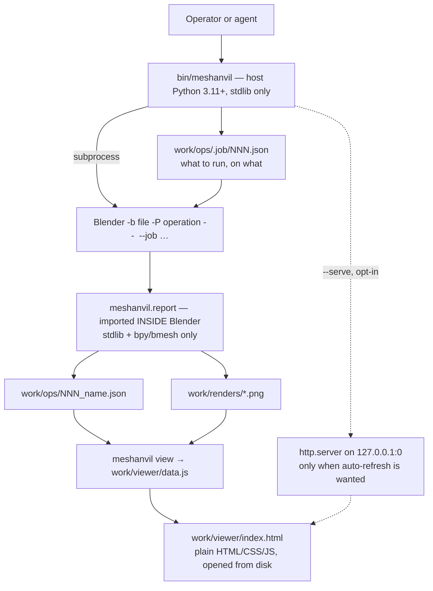

## adr_004_target_technology_and_process_model - Target technology and process model
> Date: 2026-08-21
> Status: Proposed
> Related request: `req_000_make_every_3d_operation_reviewable_without_reopening_blender`
> Related backlog: `item_002_run_one_named_operation_from_a_single_agent_agnostic_command`
> Related task: `task_001_deliver_the_reviewable_operation_loop`
> Drivers: two Python interpreters that cannot share imports, a viewer that must open with no server, an install cost near zero for someone who came for the 3D
> Reminder: Update status, linked refs, decision rationale, consequences, and follow-up work when you edit this doc.
> Indicators reviewed: 2026-08-21 22:27:37

# Overview
- Stdlib Python on both sides of a process boundary, a JSON job in and a JSON report out, and a viewer that is a plain page reading a generated data file -- no framework, no build step, and no dependency a 3D user has to install beyond Blender itself.

# Context
- Blender 5.2 embeds Python 3.13.13; the machine this was developed on runs 3.11.15. The two interpreters cannot share an import, a virtualenv or a package. Any code that touches `bpy` runs in Blender's interpreter and nothing else.
- cm-sim already solved the same boundary: a job JSON is written, Blender is launched on a worker script, the worker writes a result JSON, and the worker is documented as "run by Blender, never imported by the UI". That contract is proven in the same house and is reused rather than reinvented.
- The audience is someone who came for 3D work. Every dependency they must install before seeing anything is a reason to stop. Blender is unavoidable; a package manager, a virtualenv and a Node toolchain are not.
- `adr_003` already settled that the viewer only reads. That removes the reason most local tools need a server: there is nothing to post.
- A page opened from disk cannot `fetch` a neighbouring JSON file -- browsers refuse it as a cross-origin request. A classic `<script src>` on the same directory is not subject to that restriction, which is what makes a serverless viewer possible at all.
- The mockup drew the operation graph, the wipe and the whole interface with plain SVG and CSS, no library. It is evidence that the DAG needs no diagramming dependency.

# Decision
- **Host side: Python 3.11 or later, standard library only.** `bin/meshanvil` is the entry point. No third-party runtime dependency, no virtualenv required, no packaging step to try the tool. `subprocess`, `json`, `hashlib`, `argparse`, `http.server` cover everything the runner needs.
- **Blender side: a module imported inside Blender, `bpy`/`bmesh` plus stdlib.** The report writer lives there because only Blender can measure the scene. It must never be imported by the host process, and the host must never import `bpy`.
- **The boundary is a file, not a pipe.** The host writes a job JSON, launches `blender -b <file> -P <operation> -- --job <path>`, and reads the report the operation wrote. stdout stays human output; nothing is parsed out of it. A crashed Blender leaves a job and no report, which is a diagnosable state rather than a truncated stream.
- **The process model takes more than one engine.** Blender cannot read STEP, and the true source of this project is a 508 MB STEP file. FreeCAD 1.0 is installed and runs a script headless -- as `/Applications/FreeCAD.app/Contents/MacOS/FreeCAD -c <script>`, on Python 3.11.13, not as the `freecadcmd` name the README claimed. Since the boundary is a job file and not an import, a FreeCAD operation is the same contract with a different binary: `engine` names it, `MESHANVIL_FREECAD` overrides its path, and everything downstream is unchanged.
- **Operations stay ordinary Blender scripts.** They keep running under a bare `blender -b file -P script`, with the report writer degrading to stdout when no job is present. The runner is a convenience over them, never a prerequisite.
- **The viewer is written in plain JavaScript, typed with JSDoc and checked by `tsc --checkJs --noEmit`.** Types where they pay -- the report contract -- without a bundle, without an emitted artefact, and without breaking a page opened from disk. The house precedent agrees: the Logics viewer's own sources are plain `.js` modules bundled to an IIFE; its TypeScript serves the VS Code extension, not the viewer.
- **No React, and the trigger to revisit is written down.** The viewer's state is five values -- selected operation, workspace, image view, compare view, wipe position -- across six render functions with no cross-invalidation. React earns its keep when state outgrows manual invalidation: combined filters, multi-selection, a virtualised list over thousands of operations. Any of those arriving is the moment to port, not before.
- **The migration path is known, so the decision is cheap to reverse.** Sources move to `.ts`, esbuild bundles them `--format=iife`, and the page keeps loading a classic script. A module build would not: `<script type="module">` is refused from `file://` by the same policy that blocks a `fetch` of a neighbouring JSON, which would cost the serverless viewer.
- **The viewer is a plain page: HTML, CSS and JavaScript, no framework and no build.** `meshanvil view` writes `work/viewer/data.js` -- the reports as one assignment -- next to a static `index.html`, then opens it. It works from `file://`, offline, with no process left running.
- **A server is opt-in.** `meshanvil view --serve` starts `http.server` bound to `127.0.0.1` on port 0 for auto-refresh while a chain is running. It serves `work/` read-only. That is the only mode that keeps a process alive.
- **The graph is drawn with our own SVG.** Bezier links between absolutely positioned nodes, as the mockup already demonstrates. Mermaid stays for `Export chain as Mermaid`, which produces diagram text for a Logics document and renders nothing here.
- **No publication yet.** No PyPI package, no npm package, no installer. The repository is cloned and run. The npm devDependency remains for the corpus tooling only, as `adr_002` decided.
- **Cross-platform by environment variable.** `MESHANVIL_BLENDER` overrides the Blender path; the documented default is the macOS location. Nothing else is platform-specific.

# Consequences
- Someone with Blender installed can clone and run an operation with no other setup. That is the acceptance bar for the install cost, and it is checkable.
- Three interpreters now: the host on 3.11+, Blender on 3.13, FreeCAD on 3.11. None of them import each other. The rule generalises rather than complicates: engine code imports its engine, host code imports neither.
- Two codebases in one repository with a hard rule between them: `tools/` and `pipeline/` import `bpy`, `bin/` and the host module never do. A host module importing `bpy` is a defect, and it is cheap to check.
- The report writer cannot use anything Blender does not ship. No `pydantic`, no schema library: validation is a function.
- The serverless viewer duplicates the report data into `data.js`. For a chain of tens of operations that is kilobytes; renders stay referenced by path, not inlined, so the page stays small. If a chain ever makes that file heavy, `--serve` already exists as the answer.
- Correction to `adr_002`: the vendored Mermaid bundle is no longer what draws the chain, since the graph is our own SVG. The dependency stands on the pinned CLI and the viewer conventions; Mermaid is now only an export format.
- Type checking runs in `make check` once the viewer exists, on the same footing as the Python compile step. The configuration lands with the code it checks, not before: a `tsconfig.json` checking nothing is a file that only ever gets stale.
- The report contract is authored in Python and typed again in JSDoc. That duplication is deliberate and small; if the two drift, the fixture catches it, because the viewer reads reports the fixture produced.
- Choosing plain JavaScript here diverges from cts, which is React and Vite. The reason is the constraint those repositories do not have: a page that must open from disk with no server and no build.
- No packaging means no version pinning for users and no installation story. Acceptable while the audience is one person and the value is the method, not the distribution. It becomes a decision to revisit the day someone else wants to run it.

# References
- The boundary contract this reuses: the cm-sim Blender worker, job JSON in and result JSON out
- The read-only constraint it builds on: `adr_003_the_viewer_reads_the_command_acts`
- The report it carries: `adr_001_operation_report_format`
- Related request: `req_000_make_every_3d_operation_reviewable_without_reopening_blender`
- Related backlog: `item_002_run_one_named_operation_from_a_single_agent_agnostic_command`
- Related task: `task_001_deliver_the_reviewable_operation_loop`
