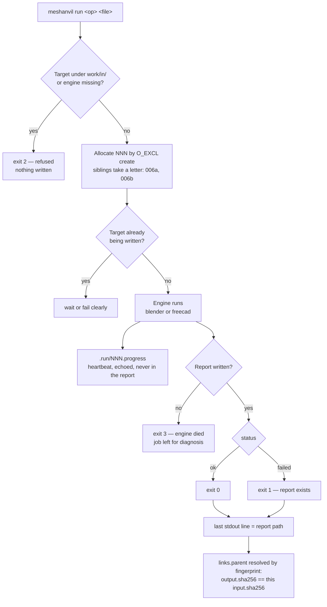

## adr_005_execution_contract_identity_concurrency_and_exit_codes - Execution contract: identity, concurrency and exit codes
> Date: 2026-08-21
> Status: Accepted
> Related request: `req_000_make_every_3d_operation_reviewable_without_reopening_blender`
> Related backlog: `item_002_run_one_named_operation_from_a_single_agent_agnostic_command`
> Related task: `task_001_deliver_the_reviewable_operation_loop`
> Drivers: an agent that must decide from an exit code, a tree that must not collide under concurrent runs, a fifteen-minute operation that must not look dead
> Reminder: Update status, linked refs, decision rationale, consequences, and follow-up work when you edit this doc.
> Indicators reviewed: 2026-08-21 22:29:18

# Overview
- What identifies an operation, what happens when two run at once, what the command returns, and how a long operation proves it is alive -- the four things an agent needs and the corpus did not state.

# Context
- Reports are named `NNN_name.json` and the branch in the mockup is `006a`, but nothing said who allocates the number or where the letter comes from.
- Two agents can run operations in the same repository at the same time. With a counter read from a directory listing, both allocate the same number and one report overwrites the other.
- `status` lives inside the report, so a caller who cannot read the report -- because Blender crashed before writing one -- has no way to tell what happened. An agent branches on the exit code, not on prose.
- The ray-visibility pass took about fifteen minutes on a 5.4 M vertex assembly with no output between the start and the end. An agent watching silence concludes a hang and kills it.
- `adr_003` refused execution from the viewer partly because of concurrency. That reason only holds if the command itself has an answer for it.

# Decision
- **Identity is allocated by creation, not by counting.** The runner allocates `NNN` by creating `work/ops/NNN_name.json` with `O_EXCL`, retrying on the next integer when the file exists. Two concurrent runners cannot obtain the same number: the filesystem arbitrates, no lock file is needed for identity.
- **A chain is identified by its root report.** `chain` in every report carries the id of the first operation of that lineage. Several chains coexist in `work/ops/` and the viewer groups by that field.
- **Siblings share an ordinal and take a letter.** When an operation's parent already has a child, the new report keeps the parent's next ordinal and takes the next free suffix: `006a`, `006b`. A single child has no suffix. The suffix records that two attempts answered the same question, which is what makes a failed attempt readable months later.
- **The parent is resolved by fingerprint.** `links.parent` is the report whose `output.sha256` equals this operation's `input.sha256`, the most recent one when several match, and absent when none does -- which makes the operation a chain root. `--from <id>` overrides it explicitly, and the report records that the parent was declared rather than derived.
- **One writer per target file.** The runner takes an exclusive lock on the output path for the duration of the operation. A second operation on the same target waits or fails with a clear message, never interleaves. Reading the same file concurrently is unrestricted.
- **Exit codes are the agent's contract.** `0` the operation ran and reported `ok`. `1` the operation ran and reported `failed`; a report exists. `2` the command refused to run -- unknown operation, bad parameter, target under `work/in/`, engine not found; no report, nothing touched. `3` the engine died without writing a report; the job file is left behind for diagnosis. The last line of stdout is always the report path, or empty on `2`.
- **A long operation proves it is alive.** The engine appends to `work/ops/.run/NNN.progress`: a timestamp, a step name and, where the operation knows it, a fraction. The runner echoes each new line. There is no default timeout -- a legitimate pass can take an hour -- but a heartbeat older than sixty seconds is reported as stale, and `--timeout` is available for a caller who wants one.
- **Progress is not a measurement.** Nothing in the progress file enters the report. It is transient, it lives under `.run/`, and it is deleted when the operation completes.

# Consequences
- An agent can drive the tool without parsing anything: run, read the exit code, read the report path from the last line. That is the whole contract.
- Concurrency has a defined answer, so the reason `adr_003` gave for keeping execution out of the viewer stops being a hidden weakness of the command itself.
- The tree is stable under parallel work: two agents branching from the same parent produce `006a` and `006b`, not a collision.
- Fingerprint-derived parents mean a chain reconstructs itself from the reports alone, with no state kept anywhere. It also means an operation run on a file that no report produced is a root, which is correct and worth stating rather than treating as an error.
- `.run/` is another directory under `work/`, transient, never versioned, and safe to delete at any time.

# References
- The report these ids live in: `adr_001_operation_report_format`
- The process model that launches the engine: `adr_004_target_technology_and_process_model`
- Why the viewer does not execute: `adr_003_the_viewer_reads_the_command_acts`
- Related request: `req_000_make_every_3d_operation_reviewable_without_reopening_blender`
- Related backlog: `item_002_run_one_named_operation_from_a_single_agent_agnostic_command`
- Related task: `task_001_deliver_the_reviewable_operation_loop`
