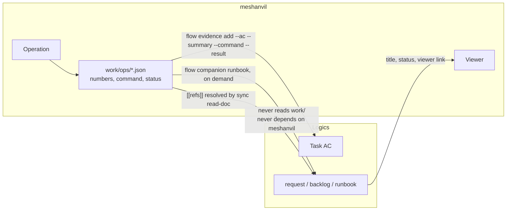

## adr_006_bridges_between_meshanvil_and_logics - Bridges between meshanvil and Logics
> Date: 2026-08-21
> Status: Proposed
> Related request: `req_000_make_every_3d_operation_reviewable_without_reopening_blender`
> Related backlog: `item_013_bridge_reports_into_the_logics_corpus`
> Related task: `task_001_deliver_the_reviewable_operation_loop`
> Drivers: a measurement that proves an acceptance criterion, one registry of documents instead of two, and two products that must stay separately publishable
> Reminder: Update status, linked refs, decision rationale, consequences, and follow-up work when you edit this doc.

# Overview
- meshanvil produces measurements; Logics needs proof. The bridge is the CLI, it runs one way, and it carries three things: a report as evidence on an acceptance criterion, document references resolved through Logics rather than through a table of our own, and a runbook scaffolded from a chain that established a procedure.

# Context
- `adr_002` bounded the coupling to the corpus checks. That boundary was drawn before the report existed, and it is too narrow: what a report contains is exactly what a Logics task closeout asks for.
- `logics-manager flow evidence add <task> --ac AC1 --summary … --command … --result …` already exists. The fields line up one to one with a report: what was verified, the command that ran, the result it produced. Nothing needs inventing on either side.
- `logics-manager sync read-doc <ref>` returns a bounded payload with the title, status, kind and linked refs of any document. The viewer needs precisely that to render a chip, and today the mockup carries a hand-written registry of ten documents that will rot the first time a title changes.
- Both products are published separately. A bridge that makes either one require the other to build or to run would make that impossible.
- The runbooks are written by hand from what a chain established. The measurements are already in the reports; the transcription is manual and lossy.

# Decision
- **The bridge is the CLI, never a shared module.** meshanvil calls `logics-manager` as a subprocess and reads JSON. No import, no library, no shared code. The same contract the engines use, for the same reason: two independent lifecycles.
- **It runs one way.** meshanvil reads and writes Logics documents; Logics never reads `work/`, never learns about reports, and never depends on meshanvil. A one-way dependency is what keeps both publishable on their own.
- **A report can become evidence, explicitly.** `meshanvil run <op> <file> --evidence task_001:AC3` records the proof through `flow evidence add` once the operation succeeded: the summary from the operation, the command as it was actually run, the result as the report path and its key measurements. Without the flag nothing is written to the corpus -- an operation is not silently a claim about a task.
- **Document references are resolved, not tabulated.** The chips in the viewer come from `sync read-doc`: title, kind and status from the source of truth, cached per run. A missing document renders as missing rather than as a stale title. This replaces the hard-coded registry the mockup used.
- **A runbook can be scaffolded from a chain.** `meshanvil runbook <chain>` calls `flow companion runbook` and prefills what the chain measured: the operations, their parameters, what failed and the numbers that showed it. The procedure and its limits are written by a person; the evidence is not retyped by one.
- **Logics is optional at runtime.** An operation runs, reports and is reviewed with no `logics-manager` installed. Only the bridges need it, and each states that it does when it is unavailable rather than failing an operation.
- **The viewer links out rather than embedding.** When a Logics viewer is running, a chip carries its URL; there is no rendering of Logics documents inside meshanvil, as `adr_002` decided and this decision keeps.

# Consequences
- A task closeout can carry machine-produced proof: the command, the report, the numbers. That is a better closeout than a sentence, and it is the reason this bridge is worth building at all.
- Titles and statuses stop being duplicated. The viewer shows what the corpus says today.
- `adr_002` is amended, not reversed: the coupling is no longer bounded to the corpus checks, but it stays a CLI boundary, one-way, and optional at runtime.
- Every bridge is a subprocess call, which costs a process start. It happens on demand -- an evidence flag, a viewer refresh, a runbook scaffold -- never in the path of an operation.
- If Logics changes its CLI, the bridges break loudly at a boundary we own, rather than silently through a shared import.
- The reverse bridge -- Logics showing an operation chain in its own viewer -- stays out of scope here. If it is ever wanted it is a request in that repository, with this decision as the record of the direction chosen.

# References
- The boundary this amends: `adr_002_depend_on_logics_manager_and_reuse_its_structure`
- The report the bridges carry: `adr_001_operation_report_format`
- The slice that builds them: `item_013_bridge_reports_into_the_logics_corpus`
- Related request: `req_000_make_every_3d_operation_reviewable_without_reopening_blender`
- Related backlog: `item_013_bridge_reports_into_the_logics_corpus`
- Related task: `task_001_deliver_the_reviewable_operation_loop`
