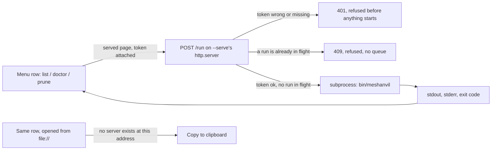

## adr_007_let_the_served_viewer_execute_a_closed_command_set - Let the served viewer execute a closed command set
> Date: 2026-08-22
> Status: Accepted
> Related request: `req_006_let_the_viewer_run_the_commands_it_already_shows_when_it_is_served`
> Related backlog: `item_032_run_a_closed_set_of_commands_from_the_served_viewer_s_own_server`, `item_033_show_a_command_s_own_output_where_its_text_used_to_sit`
> Related task: `task_020_let_the_viewer_run_the_commands_it_already_shows_when_it_is_served`
> Drivers: paying the exact price adr_003 named rather than reopening the question, keeping a file:// page exactly as safe as it always was, no operator-supplied argument ever reaching a subprocess
> Reminder: Update status, linked refs, decision rationale, consequences, and follow-up work when you edit this doc.
> Indicators reviewed: 2026-08-23 01:42:04

# Overview
- Supersedes `adr_003_the_viewer_reads_the_command_acts` for three commands only: List operations, Check setup, Preview pruning. A page opened via `meshanvil view --serve` can run them and see their result; a page opened from `file://` cannot reach a server at all and keeps copying the command to the clipboard, exactly as it did before this decision.

# Context
- `adr_003` refused execution and named its price precisely: "a local server with authentication, a job model, and a decision about concurrent access to a file Blender may already hold." It also called the refusal reversible, "so that cost is chosen deliberately rather than discovered." This is that choice, made on purpose, with the price paid in full for a command set narrow enough that the price stays small.
- `adr_004` already runs an opt-in server for `--serve`: `http.server` bound to `127.0.0.1`, port 0, serving `work/` read-only, for auto-refresh. It exists and is proven; this decision adds one endpoint to it rather than standing up a second process.
- The three commands in scope take no path, no operation name, and no operator-supplied value of any kind. They are exactly the strings the menu already prints, and this session already made that same text copyable to the clipboard -- the request is to close the remaining gap between reading a command and running it, not to open a general execution surface.
- `Refresh viewer` would ask the server handling the request to restart itself, and `Create a runbook <report-id>` shows a placeholder id with no real report behind it in the generic Help menu. Neither is safe to wire up here; both stay copy-only and are recorded as backlog for a slice that gives them a real target.
- The runner already refuses a busy target (`target_busy`) and already serialises identity allocation per project. This decision does not re-implement that: the endpoint's own single-flight guard exists only so that two clicks on the same button in the same page cannot start two subprocesses racing each other, which is a narrower problem than the runner's.

# Decision
- **One endpoint, one job model: run-to-completion, no queue.** `POST /run` on the existing `--serve` server accepts a body naming one of exactly three commands. Anything else is a refusal, not a partial match or a best-effort attempt.
- **Authentication is a per-launch token, not an account.** The server generates one random token when it starts and writes it into that build's `data.js`. Every request to `/run` must carry it in a header; a missing or mismatched token is refused before any subprocess starts. A token from a previous launch, or guessed by another localhost page, does not work: it dies with the process that made it.
- **No operator-supplied value ever reaches the subprocess.** The server holds the three fixed argument lists itself; the request body selects one by name and contributes nothing else to the command line. There is no path from a string typed into the page to a string passed to `bin/meshanvil`.
- **Concurrency is a single flight, held for the shortest useful time.** One command runs at a time; a second request while the first is still running is refused outright (not queued, not silently dropped), and the first request's caller still gets its result. This is the "concurrent access" cost adr_003 named, paid at the smallest scope that makes the button safe to click twice.
- **The two out-of-scope commands stay commands, not buttons that pretend to run.** `Refresh viewer` and `Create a runbook <report-id>` keep the copy-to-clipboard behaviour on every kind of page, served or not, until a later slice gives them what real execution would need.
- **A `file://` page is unchanged.** It has no server to reach, so detection is a read of `location.protocol`, not a capability probe: nothing about opening the plain page differently is required to keep it exactly as safe as `adr_003` made it.
- **Amendment, 2026-08-23: Open and Reveal use build-owned file ids, not page-supplied paths.** The viewer payload includes an allow-list of files already named by reports: inputs, outputs, renders, and comparison images. The page sends only the opaque id from that list to `POST /file`; the server recomputes the current allow-list and resolves the id before calling the host opener. A path string rendered in the page never becomes an argument to a subprocess or host opener request.

# Consequences
- `adr_003` moves to Superseded for the three commands this decision covers; its refusal stands unchanged for every other command, present or future, until a request pays for that one too.
- The server gains one code path with a security boundary: bind address, token, and command allow-list all have to hold at once for a subprocess to run. Each is independently cheap to audit because none of them is a general-purpose parser.
- A `--serve` session becomes slightly more capable than the plain viewer it was interchangeable with before. `adr_004`'s consequence that "`--serve` already exists as the answer" for a heavy chain now also means `--serve` is the more capable mode generally, which is worth stating rather than leaving implicit.
- Extending the command set later is a request against this ADR's own boundary, not a silent code change: the same three checks (closed set, token, single-flight) have to be re-argued for whatever is added.
- 2026-08-22, `req_008`: the start screen's two demonstration-build buttons (`tools/build_demo_chain.sh`, `tools/build_figurine_chain.sh`) were considered for this set and declined. Both are destructive by their own documented intent -- they `rm -rf` and rebuild a whole sibling project from scratch on every run -- which is a different class of action from the three read-mostly commands this ADR actually covers, and re-arguing the boundary properly (a fourth check, beyond closed-set/token/single-flight, for "safe to run unattended and repeatedly from a button") is out of scope for a UI polish pass. They stay copy-to-clipboard buttons, styled and wired like every other command row, on both `file://` and served pages.
- Open and Reveal are not part of `/run`: they are host file actions over an allow-list the server owns. A `file://` page shows them disabled because it has no server token and no route to call; Copy path remains the only working file action in that mode.

# References
- The refusal this reverses, and the price it named for reversing it: `adr_003_the_viewer_reads_the_command_acts`
- The server this adds to: `adr_004_target_technology_and_process_model`
- Related request: `req_006_let_the_viewer_run_the_commands_it_already_shows_when_it_is_served`
- Related backlog: `item_032_run_a_closed_set_of_commands_from_the_served_viewer_s_own_server`, `item_033_show_a_command_s_own_output_where_its_text_used_to_sit`
- Related task: `task_020_let_the_viewer_run_the_commands_it_already_shows_when_it_is_served`
