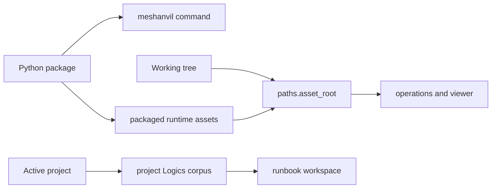

## adr_008_python_package_distribution_and_runtime_assets - Python package distribution and runtime assets
> Date: 2026-08-23
> Status: Accepted
> Related request: `req_011_make_meshanvil_an_installable_tool_instead_of_a_repository_you_clone`
> Related backlog: `item_051_declare_the_package_and_give_the_tool_a_real_entry_point`, `item_052_resolve_every_runtime_asset_the_same_way_from_a_tree_or_a_package`, `item_053_run_the_viewer_s_closed_command_set_through_the_installed_entry_point`, `item_054_decide_what_an_installed_meshanvil_offers_in_place_of_this_repository_s_corpus`, `item_055_make_releasing_a_procedure_and_state_what_was_measured`
> Related task: `task_025_deliver_an_installable_meshanvil`
> Drivers: one install command, no runtime dependencies beyond the engine, and no checkout path hidden in runtime code
> Reminder: Update status, linked refs, decision rationale, consequences, and follow-up work when you edit this doc.
> Indicators reviewed: 2026-08-23 01:55:34

# Overview
- meshanvil ships as a Python package with a `meshanvil` console script. Runtime assets are resolved by one repo-first rule: a checkout uses its local files, an installed wheel uses the files carried in the package.

# Decision
- **The distribution channel is a Python package index.** The runtime is Python, and the package declares no third-party runtime dependency. npm remains only for contributor checks and the viewer bundle.
- **Rejected channels:** npm would wrap Python in the wrong ecosystem; a graphical installer would add platform-specific work before the tool has a measured cross-platform release need; bundling Blender or FreeCAD is out of scope because those engines are the real installation cost and must remain operator-managed.
- **Installing meshanvil installs the CLI and its runtime assets, not the engines and not this repository's history.** Blender remains required, FreeCAD remains optional for STEP, and the package does not ship this repository's Logics corpus as tool content.
- **Version is single-sourced from `meshanvil.VERSION`.** The package metadata reads that attribute, and the CLI reports the same value.
- **Runtime assets use one resolver.** `paths.asset_root(name)` prefers the working tree when that asset directory is present and falls back to the installed package. The resolver covers operation manifests, operation scripts, string catalogues, viewer files and the engine-side package.
- **The served viewer invokes the installed command.** Its closed command set calls `meshanvil` from PATH, falling back to `python -m meshanvil.cli` only for an unpackaged checkout. The token, closed set and single-flight guard from `adr_007` are unchanged.
- **Runbooks come from the active project, not the installed package.** An installed tool with no Logics corpus shows the existing empty runbook state instead of pretending this repository's runbooks are product content.
- **Release is command-driven and honest about platform evidence.** Build and verification are `make package`; dry-run release is `make release-dry-run`; a release states the measured macOS, Windows and WSL evidence and names Linux as unverified until measured.

# Consequences
- `adr_004`'s "No publication yet" decision is superseded for distribution. Its stdlib runtime, engine boundary and measured-platform constraints still stand.
- A missing packaged asset fails package verification before publication, with the missing path named.
- Working from a clone remains supported through `./bin/meshanvil`; contributors still run `make check` and the smoke suites against the working tree.
- The package includes top-level `tools`, `pipeline`, `viewer` and `locales` packages only so their files have stable installed paths. They are runtime assets, not Python APIs.

# References
- Supersedes the publication part of `adr_004_target_technology_and_process_model`
- Amends runbook-source behaviour from `adr_006_bridges_between_meshanvil_and_logics`
- Preserves the served command safety decision in `adr_007_let_the_served_viewer_execute_a_closed_command_set`
