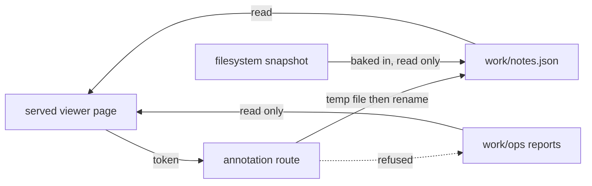

## adr_009_let_the_served_viewer_write_annotations_and_nothing_else - Let the served viewer write annotations, and nothing else
> Date: 2026-08-25
> Status: Proposed
> Related request: `req_016_make_the_viewer_s_outliner_refresh_and_annotations_hold_up_in_daily_use`
> Related backlog: `item_074_let_a_human_say_what_the_numbers_do_not_without_touching_the_reports`
> Related task: `task_029_deliver_the_viewer_s_fold_refresh_payload_and_annotation_work`
> Drivers: paying the price adr_003 named a second time rather than letting it erode quietly, a file:// page that stays exactly as safe as it always was, and an annotation file no partial write can corrupt
> Reminder: Update status, linked refs, decision rationale, consequences, and follow-up work when you edit this doc.
> Indicators reviewed: 2026-08-25 00:19:24

# Overview
- The served viewer may write one file, `work/notes.json`, through one guarded endpoint, and may still write nothing else. Reports, sources and every other artefact stay read-only to the page.

The page gains exactly one arrow that writes, and it lands on one file. Every other arrow
into an artefact stays read-only, which is what adr_003 established and what this decision
narrows rather than reopens.

# Context
- `adr_003` set the rule that the viewer reads and the command acts. `adr_007` superseded it for three commands -- List operations, Check setup, Preview pruning -- all of which read and none of which writes.
- Annotations are the first content a person authors inside the page. Storing them means the page has to cause a write, which is a different crossing from running a read-only command, and one adr_007 did not license.
- The reports under `work/ops` are the record of what an engine did, and the project's premise is that every number in them came out of that engine. Prose written by a person cannot go in them without diluting exactly what makes them evidence.
- A page opened from the filesystem has no server to write through, and adr_003's refusal still stands there in full.
- Two POST endpoints already exist on the served server -- the run route and the file route, in `meshanvil/viewer_routes` -- both requiring a per-launch token and both refused on a cross-origin request.

# Decision
- One POST endpoint accepts an annotation write: a note keyed by report identity, or a name keyed by the sha256 of a chain's source file. Nothing else is writable.
- It requires the same per-launch token as those two routes, and is refused on the same origin and host checks. A page that cannot present the token cannot write.
- The endpoint writes the whole annotation file atomically -- a temporary file in the same directory, then a rename -- so a crash or a second writer can leave a stale file but never a truncated one. Writes are serialised on the server the way the run route already serialises its subprocess.
- The endpoint refuses any path outside the annotation file, and never accepts a path from the request at all: the file is derived from the project root the server was launched with.
- The page never writes to `work/ops`. A check fails if an annotation write modifies any file there.
- A page opened from the filesystem reads annotations from the payload and refuses to write, saying why rather than failing silently.

# Consequences
- The viewer becomes an editor of one file. That is a real change of nature and the reason this is recorded rather than done quietly; anything later that wants a second writable file has to come back here.
- Last writer wins. Two pages open on the same project will overwrite each other's annotation file, and the atomic write means the loser's text is gone rather than mangled. Reconciling concurrent edits is deliberately out of scope.
- An annotation outlives the report it describes unless something removes it: `prune` deletes reports and knows nothing about notes. The backlog item carries the decision on what happens to an orphaned note.
- The served payload and the filesystem snapshot diverge: one fetches annotations and can write them, the other carries them baked in and cannot.
- `adr_003` stays superseded only for what adr_007 and this decision name. Everything else the viewer might want to do is still refused.

# References
- Related request: `req_016_make_the_viewer_s_outliner_refresh_and_annotations_hold_up_in_daily_use`
- Related backlog: `item_074_let_a_human_say_what_the_numbers_do_not_without_touching_the_reports`
- Related task: `task_029_deliver_the_viewer_s_fold_refresh_payload_and_annotation_work`
