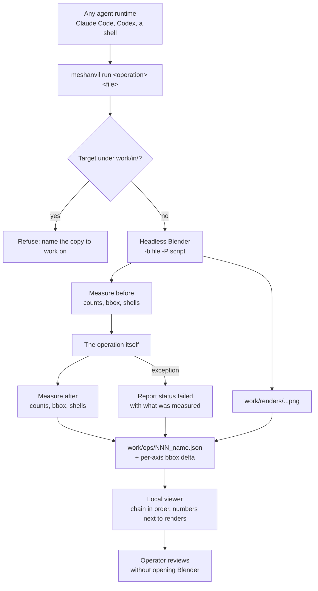

## prod_001_reviewable_agent_driven_3d_operations - Reviewable agent-driven 3D operations
> Date: 2026-08-21
> Status: Proposed
> Related request: `req_000_make_every_3d_operation_reviewable_without_reopening_blender`
> Related backlog: `item_001_define_the_operation_report_and_write_one_from_every_operation`, `item_002_run_one_named_operation_from_a_single_agent_agnostic_command`, `item_003_read_the_chain_of_operations_in_a_local_viewer`
> Related task: `task_001_deliver_the_reviewable_operation_loop`
> Related architecture: (none yet)
> Reminder: Update status, linked refs, scope, decisions, success signals, and open questions when you edit this doc.
> Indicators reviewed: 2026-08-21 22:28:44

# Overview
Turns each headless 3D operation into a self-describing unit of work: one command runs it, one report records what it did and how that was verified, and one local viewer makes the chain readable without opening the 3D application. The measurement discipline the runbooks describe becomes something the tooling produces by default rather than something the operator has to remember.

# Goals
- Make the result of an operation reviewable from its report alone.
- Make the verification -- the bounding-box comparison above all -- automatic rather than a step an agent may skip.
- Give the operator a way to navigate the chain of operations and see what each one changed.
- Keep the contract agent-agnostic: one command, one JSON report, no runtime-specific integration.
- Keep every generated artefact under work/, so a public repository never carries private geometry.

# Non-goals
- Replacing Blender's interface, or editing geometry from the viewer.
- A hosted or networked service. The viewer is local and reads files from disk.
- A general-purpose 3D asset pipeline. The operations are the ones the runbooks describe.
- An extension point inside the Logics viewer. If that need is confirmed later it belongs to logics-manager, not here.
- Committing reports, renders or sources to the repository.

# Scope and guardrails
- In: the report an operation writes, the command that runs one, the viewer that reads the chain, and the lifecycle of what they produce.
- Out: the geometric procedures themselves, which belong to the runbooks in `logics/runbook/`.
- Everything generated stays under `work/`, which is not versioned. A public repository never carries private geometry.
- No operation writes to `work/in/`. Losing a source by overwriting it is the irreversible mistake of this domain.
- The tooling records; it does not decide. A report states what was measured and what was not checked, and leaves the judgement to whoever reads it.

# Key product decisions
- One envelope, two payloads: a transform reports before and after, an inspection reports findings. Settled in `adr_001_operation_report_format`.
- The bounding-box comparison is computed by the report writer, not by the operation, because it is the check that caught every failure in the delivered chain while the manifold checks passed throughout. A verification an agent can forget is not a verification.
- What was not checked is stated as a warning code, so an agent can act on it and a reader is never left assuming.
- A failed operation is a branch of the history, kept and rendered, not a run to discard. `run_007` records three failed approaches, and they carry most of that runbook's value.
- Lineage lives in the files: a parent report id and wiki-style document references, no index and no database. A report stays understandable opened alone, years later, without the tool that wrote it.
- Reports are records and artefacts are files. Pruning deletes heavy artefacts and never the record of what was done.

# Success signals
- An operator reviews what an operation did from its report and renders, without opening Blender.
- A wrong result is caught by the report before it reaches the next operation, rather than several steps later.
- The same operation runs identically whether a person, Claude Code or Codex invoked it.
- A failed approach can be found and read months later, with the numbers that made it fail.

# Open questions
- A graph view of the operation tree, in the manner of Obsidian, remains open. The decision today is a deterministic top-down DAG: on this node count a force-directed layout says less than a tree and discards the ordering, which is the most useful axis. The question to answer before revisiting it is which question a graph would answer that a tree does not.
- Whether the runner is eventually packaged as an agent plugin (skills plus a bounded MCP surface) alongside the plain command. The command stays the contract either way; a plugin would be a convenience on top, never a prerequisite.
- Where the boundary sits between an operation and a chain of operations, once several are run in sequence: whether a chain is itself an operation with its own report, or only a path through the tree.

# References
- Report format decision: `adr_001_operation_report_format`
- Product back-reference: `req_000_make_every_3d_operation_reviewable_without_reopening_blender`
- Task back-reference: `task_001_deliver_the_reviewable_operation_loop`
