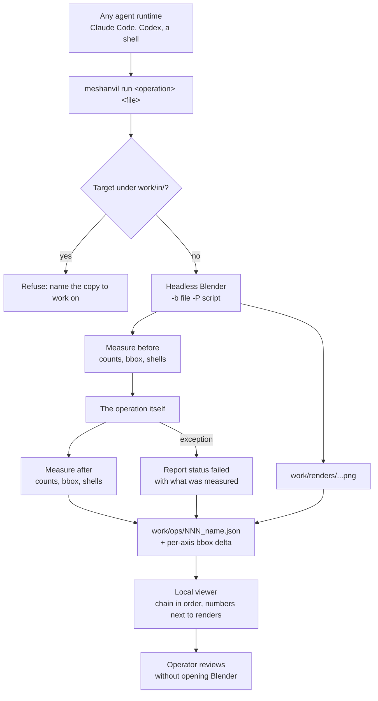

## prod_001_reviewable_agent_driven_3d_operations - Reviewable agent-driven 3D operations
> Date: 2026-08-21
> Status: Proposed
> Related request: `req_000_make_every_3d_operation_reviewable_without_reopening_blender`
> Related backlog: `item_001_define_the_operation_report_and_write_one_from_every_operation`, `item_002_run_one_named_operation_from_a_single_agent_agnostic_command`, `item_003_read_the_chain_of_operations_in_a_local_viewer`
> Related task: `task_001_deliver_the_reviewable_operation_loop`
> Related architecture: (none yet)
> Reminder: Update status, linked refs, scope, decisions, success signals, and open questions when you edit this doc.

# Overview
Turns each headless 3D operation into a self-describing unit of work: one command runs it, one report records what it did and how that was verified, and one local viewer makes the chain readable without opening the 3D application. The measurement discipline the runbooks describe becomes something the tooling produces by default rather than something the operator has to remember.

# Goals
- Make the result of an operation reviewable from its report alone.
- Make the verification -- the bounding-box comparison above all -- automatic rather than a step an agent may skip.
- Give the operator a way to navigate the chain of operations and see what each one changed.
- Keep the contract agent-agnostic: one command, one JSON report, no runtime-specific integration.
- Keep every generated artefact under work/, so a public repository never carries private geometry.

# Non-goals
- Replacing Blender's interface, or editing geometry from the viewer.
- A hosted or networked service. The viewer is local and reads files from disk.
- A general-purpose 3D asset pipeline. The operations are the ones the runbooks describe.
- An extension point inside the Logics viewer. If that need is confirmed later it belongs to logics-manager, not here.
- Committing reports, renders or sources to the repository.

# Scope and guardrails
- In: scaffolded request, product, backlog, orchestration task, validation, and handoff context.
- Out: unrelated workflow docs and implementation of generated tasks.

# Key product decisions
- Use structured input as the source of truth for generated docs.
- Keep generated write paths local and repo-bounded.

# Success signals
- Generated docs pass lint and audit without broad manual rewrites.
- Context-pack output can be handed to an implementation agent directly.

# References
- Product back-reference: `req_000_make_every_3d_operation_reviewable_without_reopening_blender`
- Task back-reference: `task_001_deliver_the_reviewable_operation_loop`
