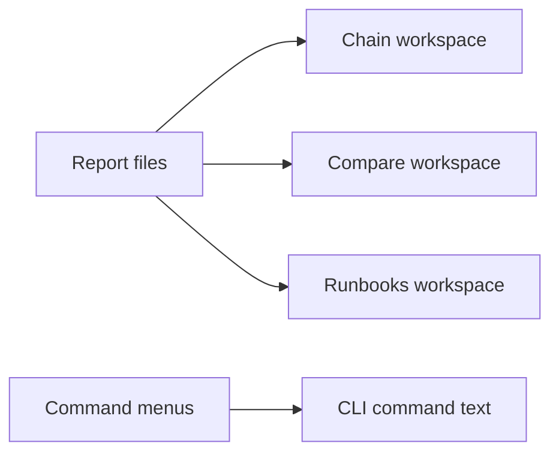

## prod_002_reviewable_local_viewer_interaction_parity - Reviewable local viewer interaction parity
> Date: 2026-08-22
> Status: Active
> Related request: `req_001_bring_the_local_viewer_up_to_the_reviewed_mockup_interaction_surface`
> Related backlog: `item_014_add_safe_workspace_navigation_and_command_discovery_to_the_viewer`, `item_015_complete_the_mockup_review_controls_without_weakening_the_local_page_boundary`, `item_016_exercise_the_viewer_in_a_real_browser_against_the_generated_fixture`
> Related task: `task_012_deliver_reviewed_viewer_interaction_parity`
> Related architecture: (none yet)
> Reminder: Update status, linked refs, scope, decisions, success signals, and open questions when you edit this doc.

# Overview
Completes the reviewed local viewer interface around the existing report-driven core. It adds discoverable navigation and command guidance while preserving the hard boundary that the page reads and the CLI acts.

# Goals
- Make the mockup's high-value review paths real and keyboard-accessible.
- Keep every action informational or copyable rather than executable from the browser.
- Verify the real page in Chrome against generated reports before accepting layout or interaction changes.

# Non-goals
- A browser-to-engine execution bridge, local privileged server or job queue.
- A framework, bundler, dependency or hosted UI service.
- Pixel-identical rendering across operating systems and fonts.
- A 3D viewport or editing geometry from the viewer.

# Scope and guardrails
- In: scaffolded request, product, backlog, orchestration task, validation, and handoff context.
- Out: unrelated workflow docs and implementation of generated tasks.

# Key product decisions
- Use structured input as the source of truth for generated docs.
- Keep generated write paths local and repo-bounded.

# Success signals
- Generated docs pass lint and audit without broad manual rewrites.
- Context-pack output can be handed to an implementation agent directly.

# References
- Product back-reference: `req_001_bring_the_local_viewer_up_to_the_reviewed_mockup_interaction_surface`
- Task back-reference: `task_012_deliver_reviewed_viewer_interaction_parity`
