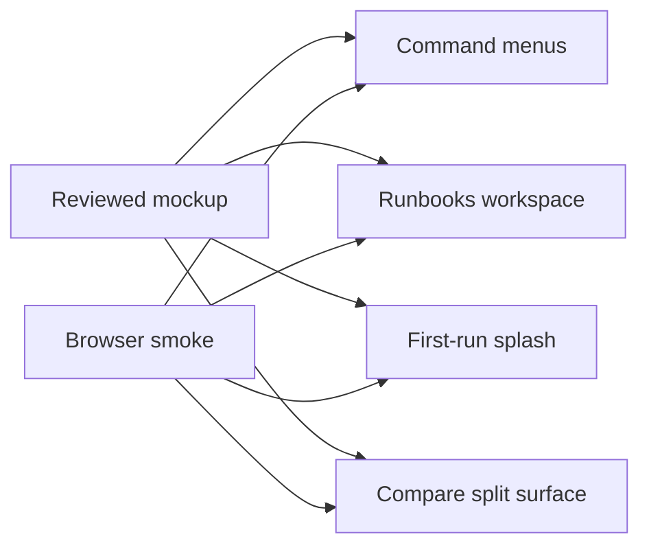

## prod_003_strict_local_viewer_mockup_parity_closure - Strict local viewer mockup parity closure
> Date: 2026-08-22
> Status: Settled
> Related request: `req_002_close_the_remaining_local_viewer_mockup_parity_gaps`
> Related backlog: `item_017_replace_minimal_menus_with_the_reviewed_command_menu_surface`
> Related task: `task_016_deliver_remaining_viewer_mockup_parity_gaps`
> Related architecture: (none yet)
> Reminder: Update status, linked refs, scope, decisions, success signals, and open questions when you edit this doc.
> Indicators reviewed: 2026-08-22 02:29:58

# Overview
Tightens the viewer parity scope after the first pass by requiring the specific reviewed mockup surfaces that remain visibly different from the current implementation.

# Goals
- Make menus, Runbooks, splash and Compare match the reviewed mockup at the structural interaction level.
- Keep the viewer read-only and local while making command guidance discoverable.
- Add browser smoke coverage that catches missing top-level mockup surfaces.

# Non-goals
- Pixel-perfect rendering for every color, font metric or platform scrollbar.
- A browser execution bridge, local daemon, job queue or engine control surface.
- A framework, bundler, new dependency or hosted UI.
- Geometry editing, report schema changes or operation behavior changes.

# Scope and guardrails
- In: scaffolded request, product, backlog, orchestration task, validation, and handoff context.
- Out: unrelated workflow docs and implementation of generated tasks.

# Key product decisions
- Use structured input as the source of truth for generated docs.
- Keep generated write paths local and repo-bounded.

# Success signals
- Generated docs pass lint and audit without broad manual rewrites.
- Context-pack output can be handed to an implementation agent directly.

# References
- Product back-reference: `item_017_replace_minimal_menus_with_the_reviewed_command_menu_surface`
- Task back-reference: `task_016_deliver_remaining_viewer_mockup_parity_gaps`
