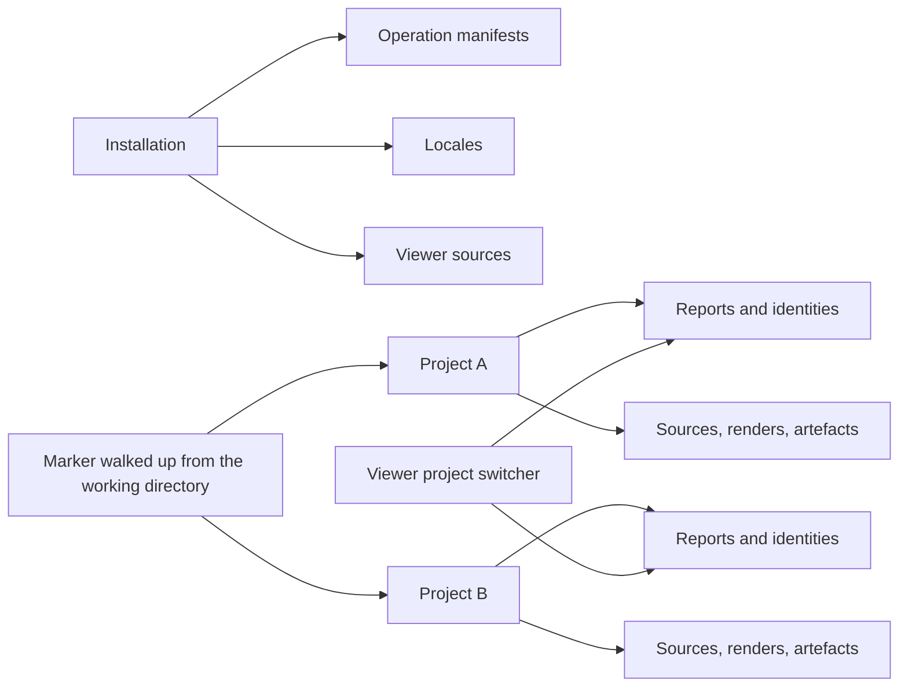

## prod_004_multi_project_operator_workspaces - Multi-project operator workspaces
> Date: 2026-08-22
> Status: Settled
> Related request: `req_003_hold_several_model_projects_side_by_side_and_switch_between_them`
> Related backlog: `item_021_split_the_code_root_from_the_work_root`
> Related task: `task_017_deliver_multi_project_workspaces_and_the_viewer_switcher`
> Related architecture: (none yet)
> Reminder: Update status, linked refs, scope, decisions, success signals, and open questions when you edit this doc.
> Indicators reviewed: 2026-08-22 15:00:07

# Overview
Lets one installation serve several model projects, each with its own reports, artefacts and viewer, and lets the operator move between them from the page instead of rebuilding it.

# Goals
- Separate where the tool is installed from where a project's work is kept.
- Make every per-project namespace -- identity, parentage, retention -- actually per project.
- Let the operator see and switch projects from the viewer without leaving read-only.
- Keep the current single-directory behaviour working with no migration.

# Non-goals
- A project database, registry service, daemon or hosted workspace.
- Comparing or merging chains across projects in one graph.
- Moving or rewriting reports that already exist on disk.
- Changing the report schema, operation behaviour or geometry results.
- Remote or shared projects, locking between machines, or multi-user access control.

# Scope and guardrails
- In: scaffolded request, product, backlog, orchestration task, validation, and handoff context.
- Out: unrelated workflow docs and implementation of generated tasks.

# Key product decisions
- Use structured input as the source of truth for generated docs.
- Keep generated write paths local and repo-bounded.

# Success signals
- Generated docs pass lint and audit without broad manual rewrites.
- Context-pack output can be handed to an implementation agent directly.

# References
- Product back-reference: `item_021_split_the_code_root_from_the_work_root`
- Task back-reference: `task_017_deliver_multi_project_workspaces_and_the_viewer_switcher`
