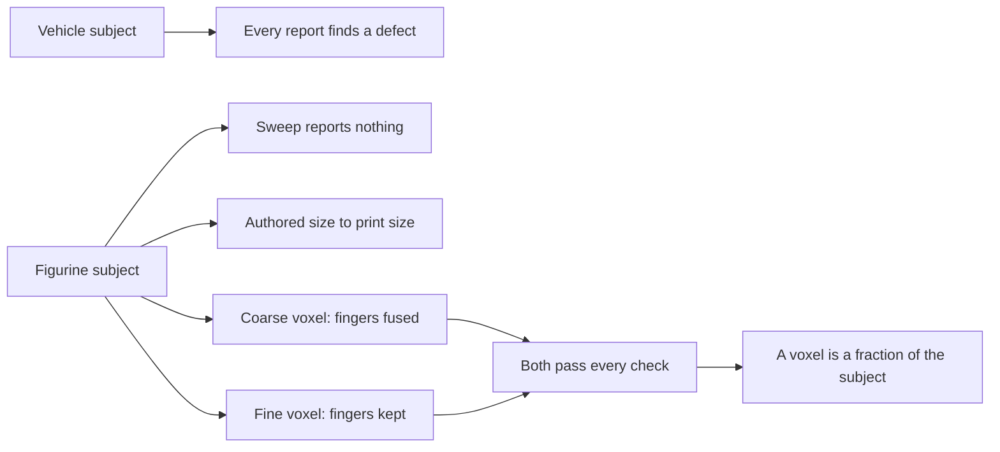

## prod_005_demonstrations_that_show_the_checks_discriminating - Demonstrations that show the checks discriminating
> Date: 2026-08-22
> Status: Settled
> Related request: `req_004_demonstrate_on_a_clean_organic_subject_what_the_vehicle_chain_cannot_show`
> Related backlog: `item_026_ship_the_figurine_subject_as_its_own_demonstration_project`
> Related task: `task_018_deliver_the_figurine_demonstration_project`
> Related architecture: (none yet)
> Reminder: Update status, linked refs, scope, decisions, success signals, and open questions when you edit this doc.
> Indicators reviewed: 2026-08-22 15:13:22

# Overview
Adds a second demonstration subject whose properties are the opposite of the first, so the chain shows sweeps staying silent on a sound model and shows that a passing check is not a guarantee the geometry survived.

# Goals
- Show what a clean result looks like, not only what a defect looks like.
- Make the relationship between voxel size and subject size visible.
- Give the multi-project work a real second project instead of an invented one.

# Non-goals
- A gallery of subjects, or one demonstration per asset class.
- Rigging, animation, texturing or sculpting workflows.
- Replacing or shortening the vehicle demonstration.
- Shipping a subject whose provenance cannot be recorded.

# Scope and guardrails
- In: scaffolded request, product, backlog, orchestration task, validation, and handoff context.
- Out: unrelated workflow docs and implementation of generated tasks.

# Key product decisions
- Use structured input as the source of truth for generated docs.
- Keep generated write paths local and repo-bounded.

# Success signals
- Generated docs pass lint and audit without broad manual rewrites.
- Context-pack output can be handed to an implementation agent directly.

# References
- Product back-reference: `item_026_ship_the_figurine_subject_as_its_own_demonstration_project`
- Task back-reference: `task_018_deliver_the_figurine_demonstration_project`
