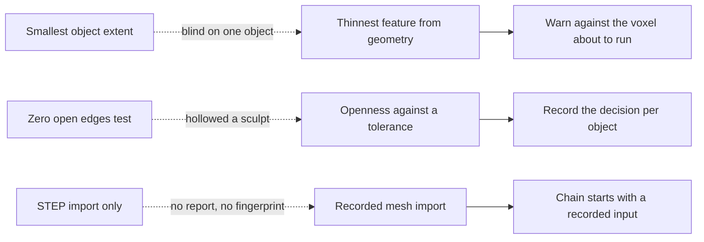

## prod_006_guards_that_measure_what_they_claim - Guards that measure what they claim
> Date: 2026-08-22
> Status: Settled
> Related request: `req_005_fix_the_guards_that_pass_while_the_geometry_is_wrong`
> Related backlog: `item_029_measure_the_thinnest_feature_not_the_smallest_object`
> Related task: `task_019_fix_the_guards_that_pass_while_the_geometry_is_wrong`
> Related architecture: (none yet)
> Reminder: Update status, linked refs, scope, decisions, success signals, and open questions when you edit this doc.
> Indicators reviewed: 2026-08-22 14:31:42

# Overview
Corrects three checks that report a number answering a different question than the one asked, all found by running the existing operations on asset classes the demonstration does not cover.

# Goals
- Make the thin-feature guard measure geometry rather than object bounds.
- Make the walling decision proportional rather than all-or-nothing.
- Let a mesh source enter the pipeline without a hand-run script.

# Non-goals
- A general mesh analysis library or a thickness solver of research quality.
- Automatic repair of arbitrary non-manifold geometry.
- Import formats nobody in this project has a source for.
- Changing the report schema or existing report contents.

# Scope and guardrails
- In: scaffolded request, product, backlog, orchestration task, validation, and handoff context.
- Out: unrelated workflow docs and implementation of generated tasks.

# Key product decisions
- Use structured input as the source of truth for generated docs.
- Keep generated write paths local and repo-bounded.

# Success signals
- Generated docs pass lint and audit without broad manual rewrites.
- Context-pack output can be handed to an implementation agent directly.

# References
- Product back-reference: `item_029_measure_the_thinnest_feature_not_the_smallest_object`
- Task back-reference: `task_019_fix_the_guards_that_pass_while_the_geometry_is_wrong`
