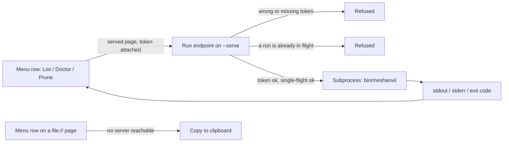

## prod_007_a_served_viewer_that_can_run_what_it_already_shows - A served viewer that can run what it already shows
> Date: 2026-08-22
> Status: Settled
> Related request: `req_006_let_the_viewer_run_the_commands_it_already_shows_when_it_is_served`
> Related backlog: `item_032_run_a_closed_set_of_commands_from_the_served_viewer_s_own_server`
> Related task: `task_020_let_the_viewer_run_the_commands_it_already_shows_when_it_is_served`
> Related architecture: `adr_007_let_the_served_viewer_execute_a_closed_command_set` (supersedes `adr_003_the_viewer_reads_the_command_acts` in part)
> Reminder: Update status, linked refs, scope, decisions, success signals, and open questions when you edit this doc.
> Indicators reviewed: 2026-08-22 17:28:28

# Overview
Reverses adr_003's refusal to execute, on the terms adr_003 itself priced: a local server, a per-launch token, and one command at a time, limited to the closed set of commands the menu already prints.

# Goals
- Let the three safe, argument-free menu commands run from a served viewer page and show their result in place.
- Keep a plain file:// page exactly as safe as it is today -- copy-to-clipboard, nothing more.
- Record the reversal as a superseding ADR rather than editing adr_003's decision in place.

# Non-goals
- Running `meshanvil run <operation> <source>` or any command that takes an operator-supplied argument.
- A job queue, a task history, or cancellation of an in-flight command.
- Authentication beyond a single per-launch token; no accounts, no login, no remote access.
- Wiring `Refresh viewer` or `Create a runbook <report-id>` to real execution.

# Scope and guardrails
- In: scaffolded request, product, backlog, orchestration task, validation, and handoff context.
- Out: unrelated workflow docs and implementation of generated tasks.

# Key product decisions
- Use structured input as the source of truth for generated docs.
- Keep generated write paths local and repo-bounded.

# Success signals
- Generated docs pass lint and audit without broad manual rewrites.
- Context-pack output can be handed to an implementation agent directly.

# References
- Product back-reference: `item_032_run_a_closed_set_of_commands_from_the_served_viewer_s_own_server`
- Task back-reference: `task_020_let_the_viewer_run_the_commands_it_already_shows_when_it_is_served`
