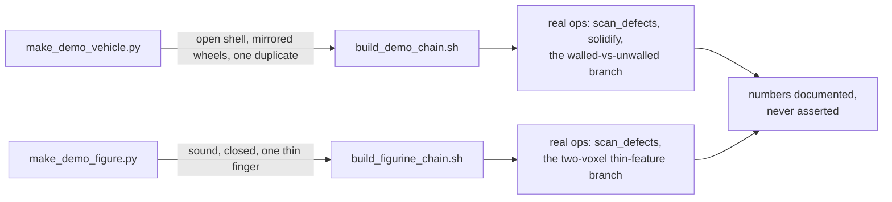

## prod_008_demonstrations_that_own_every_asset_they_run_on - Demonstrations that own every asset they run on
> Date: 2026-08-22
> Status: Settled
> Related request: `req_007_replace_the_removed_demonstration_assets_with_procedurally_generated_ones`
> Related backlog: `item_034_generate_a_vehicle_scale_subject_that_carries_the_same_defects`
> Related task: `task_021_replace_the_removed_demonstration_assets_with_procedurally_generated_ones`
> Related architecture: (none yet)
> Reminder: Update status, linked refs, scope, decisions, success signals, and open questions when you edit this doc.
> Indicators reviewed: 2026-08-22 19:03:56

# Overview
Rebuilds both demonstration subjects from primitives instead of a downloaded donor file, so the two chains that teach the project's central lessons carry no licence to verify and no trace to remove.

# Goals
- A vehicle-scale subject that reproduces the same defects the removed asset carried: unapplied modifiers, thin-walled panels, a coincident duplicate.
- A figurine-scale subject that stays sound under the defect sweep and carries a real thin feature for the voxel-size lesson.
- Both build scripts work with no argument, generating their own subject on the fly.

# Non-goals
- Photorealistic or production-quality modelling; a low-poly primitive-built subject is the target, not a sculpt.
- Reproducing the exact numbers the removed assets measured -- the lesson each branch carries matters, not matching a deleted file's specific figures.
- A general-purpose procedural asset library beyond these two subjects.

# Scope and guardrails
- In: scaffolded request, product, backlog, orchestration task, validation, and handoff context.
- Out: unrelated workflow docs and implementation of generated tasks.

# Key product decisions
- Use structured input as the source of truth for generated docs.
- Keep generated write paths local and repo-bounded.

# Success signals
- Generated docs pass lint and audit without broad manual rewrites.
- Context-pack output can be handed to an implementation agent directly.

# References
- Product back-reference: `item_034_generate_a_vehicle_scale_subject_that_carries_the_same_defects`
- Task back-reference: `task_021_replace_the_removed_demonstration_assets_with_procedurally_generated_ones`
