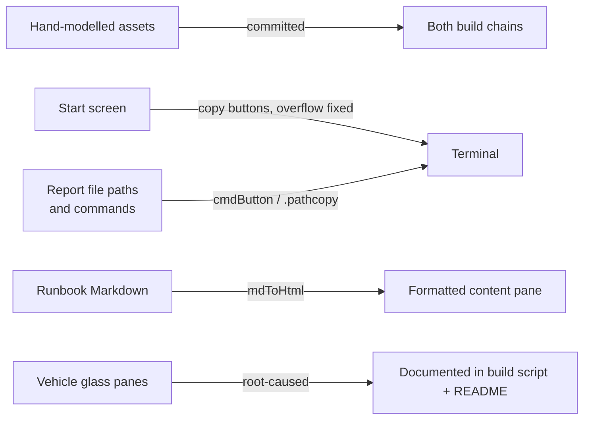

## prod_009_a_viewer_that_acts_on_what_it_shows_not_just_displays_it - A viewer that acts on what it shows, not just displays it
> Date: 2026-08-22
> Status: Settled
> Related request: `req_008_make_the_viewer_s_start_screen_runbooks_and_file_references_actionable`
> Related backlog: `item_036_commit_the_two_hand_modelled_demo_assets_as_project_fixtures`
> Related task: `task_022_deliver_the_viewer_actionability_pass`
> Related architecture: (none yet)
> Reminder: Update status, linked refs, scope, decisions, success signals, and open questions when you edit this doc.
> Indicators reviewed: 2026-08-22 23:56:52

# Overview
Closes the gap between the viewer showing a command, a file path, or a runbook and the operator actually being able to act on it -- run it, open it, or read it formatted -- while keeping the viewer's no-framework, no-build-step, read-only-by-default character intact.

# Goals
- The two hand-modelled demonstration assets are part of the committed project, not a personal local-only convenience.
- The start screen is usable at common widths and honest about what its template commands can and cannot do from a served page.
- Every file path and runnable command the viewer already prints is a real control, not text a person has to retype.
- Runbook content is legible prose, not raw Markdown source.
- The vehicle demonstration's glass panes survive the chain, or the chain is honest about why they don't.

# Non-goals
- Extending the served page's command set to arbitrary shell commands; any addition stays closed and explicit, per adr_007.
- A general Markdown library or a WYSIWYG editor; a small renderer covering this project's own runbook conventions is the target.
- Reworking the viewer's overall layout system beyond fixing the specific overflow found.

# Scope and guardrails
- In: scaffolded request, product, backlog, orchestration task, validation, and handoff context.
- Out: unrelated workflow docs and implementation of generated tasks.

# Key product decisions
- Use structured input as the source of truth for generated docs.
- Keep generated write paths local and repo-bounded.

# Success signals
- Generated docs pass lint and audit without broad manual rewrites.
- Context-pack output can be handed to an implementation agent directly.

# References
- Product back-reference: `item_036_commit_the_two_hand_modelled_demo_assets_as_project_fixtures`
- Task back-reference: `task_022_deliver_the_viewer_actionability_pass`
