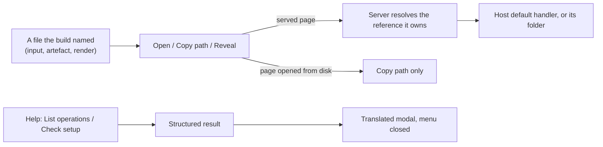

## prod_010_direct_controls_over_the_files_and_results_the_viewer_already_names - Direct controls over the files and results the viewer already names
> Date: 2026-08-23
> Status: Proposed
> Related request: `req_009_turn_the_viewer_s_file_references_and_command_rows_into_direct_translated_controls`
> Related backlog: `item_041_replace_each_file_reference_with_an_icon_only_open_copy_and_reveal_group`, `item_042_let_the_served_page_open_and_reveal_a_file_the_build_already_knows`, `item_043_show_list_and_setup_results_as_translated_modals_reached_from_help`, `item_044_cover_the_new_controls_and_modals_in_the_viewer_smoke_suite`
> Related task: `task_023_deliver_the_viewer_s_direct_file_controls_and_translated_result_modals`
> Related architecture: (none yet)
> Reminder: Update status, linked refs, scope, decisions, success signals, and open questions when you edit this doc.
> Indicators reviewed: 2026-08-23 00:18:46

# Overview
Takes the viewer past showing a file reference or a command result as text: a file becomes something to open or locate, and a command result becomes a translated panel, without the viewer gaining a dependency or an open execution surface.

# Goals
- A file reference is a place the operator can go, not a string to copy and retype.
- Nothing routes the operator through a terminal for something the host system already does.
- A command's result is presented in the operator's language, in a container built for it.
- Menu rows sit in the menu that describes them.

# Non-goals
- Opening arbitrary operator-typed paths; whatever is added stays closed and derived from what the build already knows, per adr_007.
- A general file browser inside the viewer.
- An icon library or any new runtime dependency.

# Scope and guardrails
- In: scaffolded request, product, backlog, orchestration task, validation, and handoff context.
- Out: unrelated workflow docs and implementation of generated tasks.

# Key product decisions
- Use structured input as the source of truth for generated docs.
- Keep generated write paths local and repo-bounded.

# Success signals
- Generated docs pass lint and audit without broad manual rewrites.
- Context-pack output can be handed to an implementation agent directly.

# References
- Product back-reference: `req_009_turn_the_viewer_s_file_references_and_command_rows_into_direct_translated_controls`
- Task back-reference: `task_023_deliver_the_viewer_s_direct_file_controls_and_translated_result_modals`
