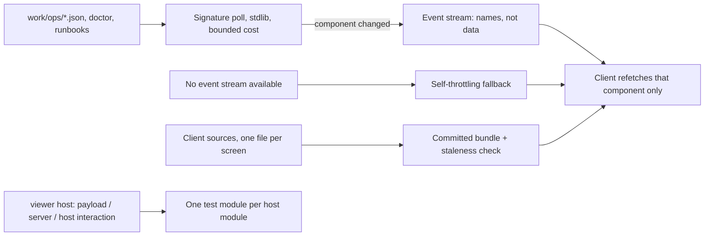

## prod_011_a_viewer_that_stays_current_and_a_codebase_that_stays_divisible - A viewer that stays current and a codebase that stays divisible
> Date: 2026-08-23
> Status: Settled
> Related request: `req_010_make_the_viewer_refresh_itself_and_give_the_code_a_module_structure_that_holds`
> Related backlog: `item_045_serve_the_viewer_payload_instead_of_baking_it_into_the_page`
> Related task: `task_024_deliver_the_live_viewer_and_the_module_structure`
> Related architecture: (none yet)
> Reminder: Update status, linked refs, scope, decisions, success signals, and open questions when you edit this doc.
> Indicators reviewed: 2026-08-23 01:27:28

# Overview
Turns the served viewer into a live view onto the reports directory instead of a snapshot, and gives both sides of it -- the host code and the page -- a module structure, a size budget and a real test layout, so the next slice edits a small file instead of the only file.

# Goals
- A running chain's reports appear in an open page without anyone restarting or reloading anything.
- Launching the viewer twice gets you the viewer you already have, at the address it always had.
- The refresh mechanism costs almost nothing when nothing is happening and adds no dependency to detect change.
- Every screen of the client and every job of the server has its own file, with a size limit that is checked rather than hoped for.
- A host module has a test module, and a failing check names the unit that broke.

# Non-goals
- A framework, a reactive runtime, or a state library on the client; modules and a bundler, nothing more.
- The caching machinery `logics-manager` needs at its scale -- ETags, status TTLs, a large endpoint surface.
- Client-side unit tests while the client modules are DOM assembly; the smoke suite covers them.
- Any change to what the viewer displays or to the report format.
- Running the viewer as a background service; it stays a foreground process the operator started.

# Scope and guardrails
- In: scaffolded request, product, backlog, orchestration task, validation, and handoff context.
- Out: unrelated workflow docs and implementation of generated tasks.

# Key product decisions
- Use structured input as the source of truth for generated docs.
- Keep generated write paths local and repo-bounded.

# Success signals
- Generated docs pass lint and audit without broad manual rewrites.
- Context-pack output can be handed to an implementation agent directly.

# References
- Product back-reference: `item_045_serve_the_viewer_payload_instead_of_baking_it_into_the_page`
- Task back-reference: `task_024_deliver_the_live_viewer_and_the_module_structure`
