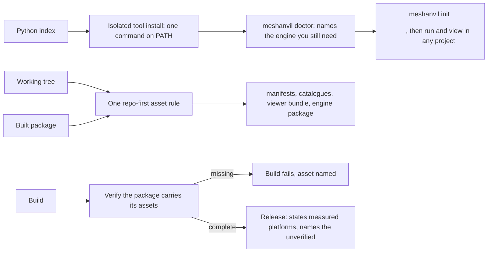

## prod_012_a_tool_you_install_not_a_repository_you_clone - A tool you install, not a repository you clone
> Date: 2026-08-23
> Status: Proposed
> Related request: `req_011_make_meshanvil_an_installable_tool_instead_of_a_repository_you_clone`
> Related backlog: `item_051_declare_the_package_and_give_the_tool_a_real_entry_point`, `item_052_resolve_every_runtime_asset_the_same_way_from_a_tree_or_a_package`, `item_053_run_the_viewer_s_closed_command_set_through_the_installed_entry_point`, `item_054_decide_what_an_installed_meshanvil_offers_in_place_of_this_repository_s_corpus`, `item_055_make_releasing_a_procedure_and_state_what_was_measured`
> Related task: `task_025_deliver_an_installable_meshanvil`
> Related architecture: (none yet)
> Reminder: Update status, linked refs, scope, decisions, success signals, and open questions when you edit this doc.
> Indicators reviewed: 2026-08-23 00:48:28

# Overview
Turns meshanvil from a source tree that has to be acquired into a command an operator installs once and uses in any project directory, without giving up the working-tree route contributors depend on and without pretending to support a platform nobody measured.

# Goals
- Getting the tool is one command, and the only real prerequisite left is the one no packaging can remove.
- The tool finds what it needs by one rule, whether it is running from a checkout or from an installed package.
- A package that is missing part of itself fails at build time, not at an operator's first run.
- What is supported and what is unverified is stated where someone about to install reads it.

# Non-goals
- Publishing through npm; nothing in the runtime is JavaScript and `adr_002` already fixed npm's role.
- A graphical installer, a bundled Blender, or any attempt to hide the engine requirement.
- Actually publishing a release in this pass -- the machinery and the decision, not the act.

# Scope and guardrails
- In: scaffolded request, product, backlog, orchestration task, validation, and handoff context.
- Out: unrelated workflow docs and implementation of generated tasks.

# Key product decisions
- Use structured input as the source of truth for generated docs.
- Keep generated write paths local and repo-bounded.

# Success signals
- Generated docs pass lint and audit without broad manual rewrites.
- Context-pack output can be handed to an implementation agent directly.

# References
- Product back-reference: `req_011_make_meshanvil_an_installable_tool_instead_of_a_repository_you_clone`
- Task back-reference: `task_025_deliver_an_installable_meshanvil`
