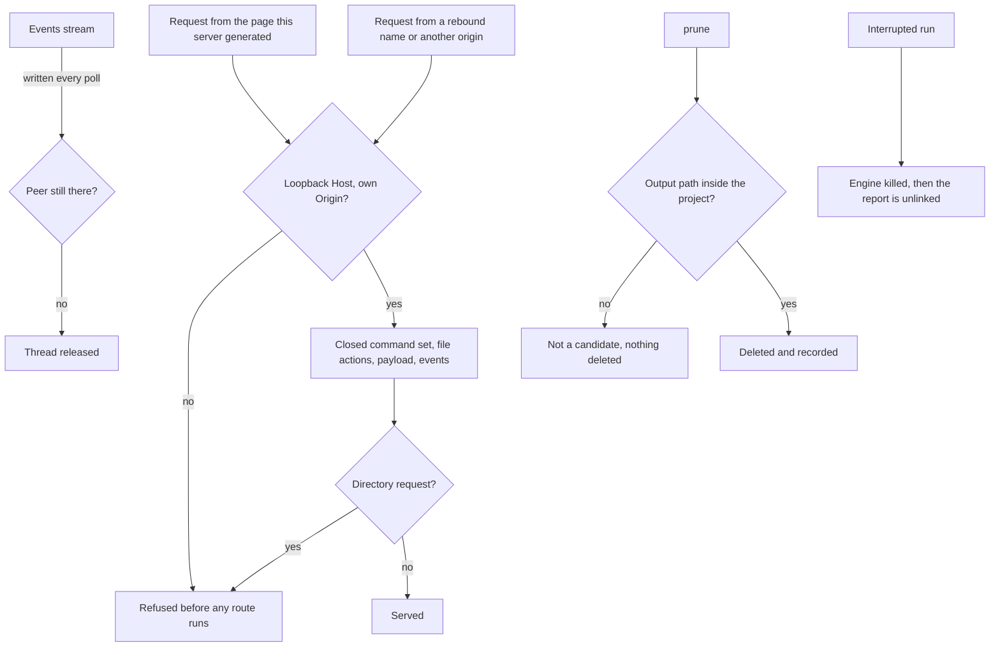

## prod_013_a_host_boundary_that_matches_its_own_documentation - A host boundary that matches its own documentation
> Date: 2026-08-23
> Status: Proposed
> Related request: `req_013_make_the_served_viewer_prune_and_project_resolution_behave_the_way_they_are_documented`
> Related backlog: `item_056_refuse_a_served_viewer_request_that_did_not_come_from_its_own_page`, `item_057_keep_prune_inside_the_project_it_was_asked_to_prune`, `item_058_stop_the_served_viewer_listing_work_and_holding_threads_for_absent_peers`, `item_059_leave_nothing_running_and_nothing_mislabelled_after_an_interrupted_run`
> Related task: `task_026_close_the_review_findings_on_the_served_viewer_prune_and_project_resolution`
> Related architecture: (none yet)
> Reminder: Update status, linked refs, scope, decisions, success signals, and open questions when you edit this doc.

# Overview
Closes the gap between what meshanvil's security-relevant host code does and what its documents say it does. It covers the served viewer's request boundary, the containment of the one destructive command, and the labels on the decision that chooses where a run lands.

# Goals
- Make the served viewer answer only requests that came from the page it generated.
- Keep the one command that deletes files inside the project it was pointed at.
- Have each security claim in SECURITY.md and adr_007 be checkable against the code it describes.
- Leave a runnable check behind for every boundary this establishes, in the suite CI already runs.

# Non-goals
- Exposing the viewer beyond loopback, or adding TLS, accounts, sessions or token rotation.
- Widening the closed command set adr_007 permits, or letting the page supply any part of a command line.
- Reworking the viewer's interface, its payload shape or its visual design.
- Changing the engine-side code under tools/ and pipeline/, or adding a Blender-dependent check to CI.

# Scope and guardrails
- In: scaffolded request, product, backlog, orchestration task, validation, and handoff context.
- Out: unrelated workflow docs and implementation of generated tasks.

# Key product decisions
- Use structured input as the source of truth for generated docs.
- Keep generated write paths local and repo-bounded.

# Success signals
- Generated docs pass lint and audit without broad manual rewrites.
- Context-pack output can be handed to an implementation agent directly.

# References
- Product back-reference: `req_013_make_the_served_viewer_prune_and_project_resolution_behave_the_way_they_are_documented`
- Task back-reference: `task_026_close_the_review_findings_on_the_served_viewer_prune_and_project_resolution`
