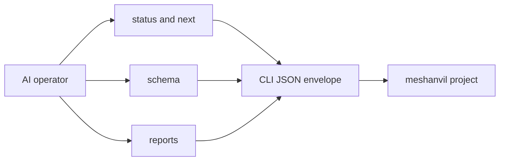

## prod_014_an_agent_ready_command_surface_for_meshanvil - An agent-ready command surface for meshanvil
> Date: 2026-08-23
> Status: Proposed
> Related request: `req_014_make_the_cli_a_dependable_surface_for_ai_operators`
> Related backlog: `item_060_expose_report_operation_and_cli_schemas_from_the_tool`, `item_061_add_one_status_json_command_for_agent_preflight`, `item_062_let_agents_list_and_read_reports_through_the_cli`, `item_063_standardize_json_success_and_error_envelopes`, `item_064_give_actionable_refusals_stable_error_codes`, `item_065_add_a_next_action_command_that_advises_without_acting`, `item_066_document_the_agent_operating_contract`
> Related task: `task_027_deliver_the_agent_ready_cli_contract`
> Related architecture: (none yet)
> Reminder: Update status, linked refs, scope, decisions, success signals, and open questions when you edit this doc.
> Indicators reviewed: 2026-08-23 11:21:41

# Overview
Makes meshanvil usable by AI operators through explicit schemas, a single status view, report access commands, stable JSON errors, next-action advice and a short agent playbook, without adding an agent runtime.

# Goals
- An AI can discover what meshanvil can do without reading Python source.
- An AI can decide the next safe command from one status response.
- An AI can list and read reports through a stable CLI contract instead of filesystem conventions.
- JSON output stays parseable and stable across locales.
- The human CLI remains friendly and unchanged unless `--json` is requested.

# Non-goals
- No autonomous planner or agent framework.
- No MCP server or background daemon.
- No change to report semantics or operation execution.
- No versioned sample data from `work/`.
- No localization of machine identifiers or error codes.

# Scope and guardrails
- In: schema, status, reports, stable JSON envelopes, stable refusal codes, next-action advice, and a short AI operator guide.
- Out: an agent framework, MCP server, background daemon, report semantic changes, operation execution changes, and versioned `work/` sample data.

# Key product decisions
- Keep this as CLI plus JSON. Agents get a dependable command surface, not a new runtime.
- Machine identifiers and error codes are stable and untranslated; human messages can stay localized.
- Advice commands report safe next steps and never perform them.

# Success signals
- An AI can run one status command and know the project, setup, reports and next safe actions.
- An AI can validate its expectations from schema commands instead of reading Python source.
- JSON-mode failures carry stable codes and remain parseable across locales.

# References
- Product back-reference: `req_014_make_the_cli_a_dependable_surface_for_ai_operators`
- Task back-reference: `task_027_deliver_the_agent_ready_cli_contract`
