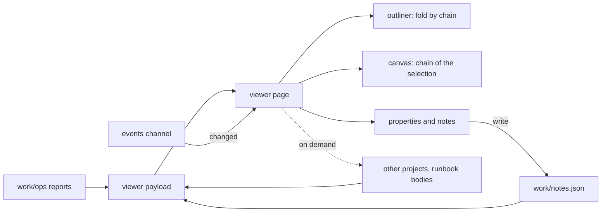

## prod_015_a_viewer_that_keeps_up_with_the_work - A viewer that keeps up with the work
> Date: 2026-08-25
> Status: Proposed
> Related request: `req_016_make_the_viewer_s_outliner_refresh_and_annotations_hold_up_in_daily_use`
> Related backlog: `item_071_fold_a_chain_and_everything_under_it_from_one_visible_control`, `item_072_keep_the_operator_s_choices_across_a_live_refresh`, `item_073_fetch_what_the_first_paint_draws_and_the_rest_when_it_is_needed`, `item_074_let_a_human_say_what_the_numbers_do_not_without_touching_the_reports`
> Related task: `task_029_deliver_the_viewer_s_fold_refresh_payload_and_annotation_work`
> Related architecture: (none yet)
> Reminder: Update status, linked refs, scope, decisions, success signals, and open questions when you edit this doc.
> Indicators reviewed: 2026-08-25 00:04:58

# Overview
The viewer is where an operator reads what the operations did. It holds up while a project is small and starts working against its user as the project grows: folding leaves orphans on screen, a background refresh undoes a deliberate choice, the live channel slows down in proportion to how much there is to watch, and the first paint pays for everything before anything is clicked. None of it is a rendering problem; all of it is state the page handles too bluntly. This brief covers making that state behave, and adding the one thing the page cannot currently hold at all -- what a human knows about a report that its numbers do not say.

The report files and the annotation file are two different kinds of record and stay apart:
operations write the first, only a person writes the second, and the page is the only place
they meet.

# Goals
- Folding follows the structure an operator sees: a chain and everything under it.
- Nothing the operator chose is undone by something happening in the background.
- Responsiveness does not degrade as the number of projects and reports grows.
- The first paint costs what the first paint draws.
- A report can carry what a person knows about it, without that ending up inside the engine's own record.

# Non-goals
- Editing reports, or writing anything a viewer could be mistaken for having measured.
- A general commenting or review system with threads, authors or notifications.
- Changing what an operation records, or the report schema.
- Rewriting the page's rendering model or introducing a UI framework.

# Scope and guardrails
- In: scaffolded request, product, backlog, orchestration task, validation, and handoff context.
- Out: unrelated workflow docs and implementation of generated tasks.

# Key product decisions
- Use structured input as the source of truth for generated docs.
- Keep generated write paths local and repo-bounded.

# Success signals
- Generated docs pass lint and audit without broad manual rewrites.
- Context-pack output can be handed to an implementation agent directly.

# References
- Product back-reference: `req_016_make_the_viewer_s_outliner_refresh_and_annotations_hold_up_in_daily_use`
- Task back-reference: `task_029_deliver_the_viewer_s_fold_refresh_payload_and_annotation_work`
